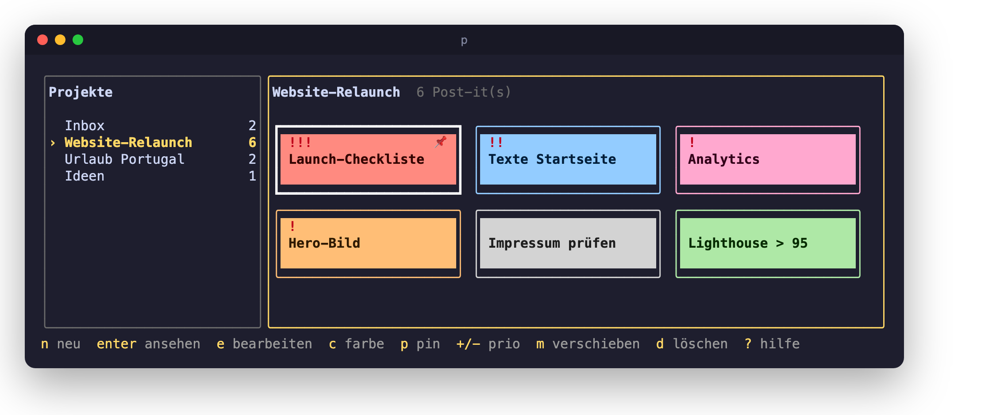
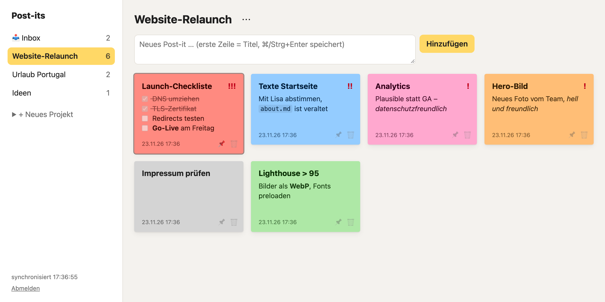

<div align="center">

# 🟨 postit

**Post-its für Leute, die im Terminal wohnen.**

Eine schnelle TUI, eine schlanke Webapp und ein Sync-Dienst, der alles zusammenhält. Offline-first, selbst gehostet, eine SQLite-Datei.




</div>

## Was drin ist

- **`p`**: Terminal-UI mit Vim-Tasten. Projekte links, Post-its als Kacheln rechts.
- **Markdown** in jedem Post-it: Überschriften, **fett**, *kursiv*, `Code`, Checklisten.
- **8 Farben, 3 Prioritäten, Pins.** Wichtiges steht oben.
- **Unterprojekte**: Jedes Projekt lässt sich unter ein anderes schieben, beliebig tief.
- **Inbox** für alles, was schnell rausmuss: `p Milch kaufen`.
- **`postit-web`**: dieselben Notizen im Browser, auch auf dem Handy und im Dark Mode.
- **`postitd`**: Sync-Dienst. Jedes Gerät hat eine eigene Kopie und arbeitet offline weiter.
- **Inbox-API**: ein `POST` legt ein Post-it ab, ideal für einen iPhone-Kurzbefehl.

## Schnellstart

```sh
go install ./cmd/p    # aus dem geklonten Repo
p                     # TUI öffnen
p "Idee: **Dark Mode**"  # direkt in die Inbox
```

Die Daten liegen in `~/.local/share/postit/postit.db` (oder `$POSTIT_DB`, `-db <pfad>`).

### Tasten

| Board | | Projekte | |
|---|---|---|---|
| `h j k l` | bewegen | `n` | neues Projekt |
| `n` | neues Post-it | `r` | umbenennen |
| `enter` / `e` | ansehen / bearbeiten | `K` / `J` | nach oben / unten schieben |
| `c` / `C` | Farbe vor / zurück | `m` | unter anderes Projekt schieben |
| `p` | anpinnen | `d` | löschen |
| `+` `-` `0`–`3` | Priorität | `tab` | zum Board |
| `m` | in anderes Projekt | `?` / `q` | alle Tasten / beenden |

`K`/`J` sortiert ein Projekt unter seinen Geschwistern. Wird ein Projekt gelöscht, rücken seine Unterprojekte eine Ebene hoch. Im Browser steht „Unterordnen“ im ⋯-Menü des Projekts.

Im Editor: `esc` speichert, `ctrl+n`/`ctrl+b` wechselt die Farbe, `ctrl+p` pinnt, `alt+↑/↓` ändert die Priorität.

## Im Browser



`postit-web` zeigt dieselben Projekte und Post-its, mit Markdown-Vorschau und Login per Passwort. Für `postitd` ist die Webapp nur ein weiteres Gerät.

## Sync einrichten

```sh
p -login https://postit.example.com   # fragt den Token ab und gleicht sofort ab
p -sync                               # manuell abgleichen
```

Danach synchronisiert `p` von selbst: beim Start, kurz nach jeder Änderung, alle 30 s und beim Beenden. Ändern zwei Geräte dasselbe Post-it, gewinnt die spätere Änderung.

**Schnell was notieren, von überall:**

```sh
curl -H "Authorization: Bearer $POSTIT_TOKEN" --data-binary 'Milch kaufen' \
     https://postit.example.com/api/v1/inbox
```

## Selbst hosten

```sh
cp .env.example .env   # Sync-Token und Web-Passwort eintragen
docker compose up -d
```

Das startet `postitd` auf `127.0.0.1:8983` und `postit-web` auf `127.0.0.1:8984`. Davor gehört ein Reverse-Proxy mit TLS. Proxy-Konfiguration, iPhone-Kurzbefehl, Backup und Betrieb stehen in **[DEPLOY.md](DEPLOY.md)**.

## Aufbau

```
cmd/p           TUI (Bubble Tea)          ┐
cmd/postit-web  Webapp                    ├─ je eine eigene SQLite-Kopie
cmd/postitd     Sync-Dienst + Inbox-API   ┘
store/          Datenbank, Änderungslog, Grabsteine für Gelöschtes
md/             Markdown fürs Terminal und fürs Web
```

```sh
go test ./...
```
